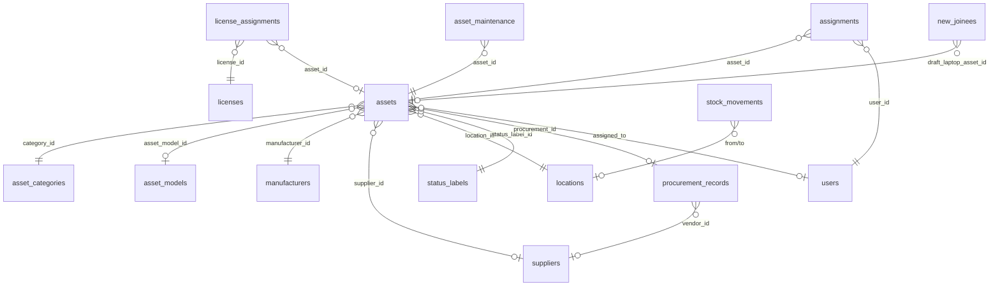
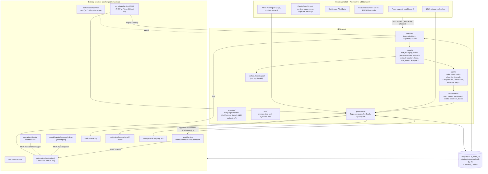

# IT-HAMS: Existing System Audit for the AI Layer (Phase 0)

| | |
|---|---|
| Date | 2026-10-22 |
| Code audited | `it-hams-update-2026-10-14` @ `9048ece` (identical to `main`) |
| Database audited | `it_hams_v3` (PostgreSQL 16.15, 80 MB) |
| Method | Code read-through, plus SQL profiling run inside `BEGIN READ ONLY … ROLLBACK`. No code, schema or data was changed. |
| Status | **Waiting for approval.** No implementation code will be written until this audit is approved. |

---

## Summary: what decides the plan

1. **The stack is Node.js 24 + Express 4 + EJS + raw SQL on PostgreSQL**, with no ORM. That makes the AI layer
   plain JavaScript under `src/ai/`, with zero new npm dependencies. The math (TF-IDF, Naive Bayes, BM25,
   Weibull MLE, Isolation Forest, Holt-Winters, knapsack) is ours, built on `Float64Array`.
   Heavy work runs in Node's built-in `worker_threads`, so the web process never blocks.
2. **The data is a single snapshot with no history.** Everything was loaded by one register import on
   2026-10-14. All 8,564 assignments carry that date and none has been returned. The 44,020 stock-ledger rows
   have no `occurred_at`. The audit log holds 24 rows. Maintenance, licences, software, accessories, requests,
   departments and verification audits all have **0 rows**.
3. **The static attributes are rich.** There are 26,736 computing assets with category, model, manufacturer,
   supplier, location, purchase date (2001–2026), warranty start and end, cost (76.5% filled), processor, RAM,
   OS, Machine Name, insurance, and a retirement reason on all 8,720 retired assets.
4. **Some requested capabilities cannot be trained on today's data.** Each one has an honest alternative
   that can be trained now (detail in C.4):
   - **Failure-risk from maintenance history** (0 rows) becomes **refresh/retirement-risk**. This is a Weibull
     model fitted to "current-status" data (age at snapshot, retired yes/no). The laptop curve has a clear
     knee: 3.5% retired at 4 years, 20% at 5, 63% at 6.
   - **Event-stream anomalies (EWMA)** become **snapshot anomalies (Isolation Forest)** now. EWMA comes once
     about 8 weeks of snapshots exist.
   - **Collaborative-filtering provisioning** is not possible because users have no department, designation
     or manager. It becomes an upgrade of the existing New Joinee recommender instead.
   - **Licence compliance** has no entitlement or install data. The rule engine gets built but stays
     dormant until the data arrives.
   - **Depreciation forecasting** is blocked because `depreciation_months` is empty on 100% of assets.
     A finance policy is needed first.
5. **Data quality is the biggest quick win.** The specific problems found are listed in C.3:
   - 458 Dell/Lenovo/HP/Apple devices are filed as "VM".
   - 1,932 "In Stock" assets have a Machine Name that says they were returned to a client.
   - The FAMS barcode holds placeholders such as "Pending" (3,156 assets).
   - Machine Name is used for status notes.
   - 6,282 assets have no cost.
   - 7,194 of 7,205 employees have no name or email (name = CTID).
6. **Much of the needed infrastructure already exists and can be reused:**
   - an in-process event system (`automationService.fire`, 11 events),
   - a scheduler with advisory locks (`schedulerService`),
   - settings with change history (usable for feature flags),
   - module toggles, RBAC with location scopes, the audit log (`activity_logs`), and in-app, email and Teams
     notifications,
   - an "AI drafts, human approves" pattern that is already live: New Joinee laptop drafts, reviewed and then
     allocated.
7. **Most data changes arrive through bulk imports, not per-asset events.** The register sync
   (`assetRegisterSync.applySync`) writes thousands of rows without firing `asset.*` events. The AI layer
   must therefore also recompute after each import, not only listen to the form events.
8. **The safety net is thin.** `npm test` passes 10/10, but every test covers only the heartbeat agent.
   "Zero regressions" cannot be proven with the current suite, so M1 adds smoke tests for the existing
   pages before any hook goes in.

---

## A. Technical inventory

### A.1 Stack and versions

| Layer | Technology | Version | Notes |
|---|---|---|---|
| Runtime | Node.js | 24.19 (local) | Production readiness doc targets 20+ LTS |
| Web | Express | 4.19 | `src/app.js`; trust proxy; CSP `'self'` only |
| Views | EJS + Alpine.js + Tailwind CSS + Lucide + ApexCharts | 3.1 / 3.17 / 3.4 / 1.51 / 7.8 | Tailwind is pre-built to `public/css/app.css`. Vendor JS is served from `node_modules` at `/vendor/*`. |
| Database | PostgreSQL via `pg` | 16.15 / 8.12 | Raw parameterised SQL; helpers in `src/core/db.js` (`query/get/run/insert/tx`) |
| Sessions | express-session + connect-pg-simple | 1.18 / 9.0 | Table `sessions` |
| Files | exceljs, multer, qrcode | 4.4 / 1.4 / 1.5 | Excel import/export, uploads, QR labels |
| Mail | nodemailer | 10 | Currently disabled (`notifications.email_enabled = 0`) |
| Tests | `node:test` | built-in | `npm test` → `tests/**/*.test.js` |
| AI/ML libraries | none | | The removed AI (2026-10-14) used `@anthropic-ai/sdk`. It is not in `package.json` now. |

### A.2 Folder structure

```
bin/            hams-cli.js (migrate, seed, maintenance commands), heartbeat-agent.js
database/       13 forward-only SQL migrations (order fixed in bin/hams-cli.js:21) + seed.sql
                laptop_insights.sql exists but is NOT in the migrate list (incompatible, see A.12)
database-dump/  it_hams_v3.sql (34 MB, tracked in git; see risk R9)
src/app.js      middleware + route mounting;  src/server.js  boot, stock_site column, scheduler, heartbeat
src/config.js   .env → config object
src/core/       db, cache (in-process), logger (storage/logs/hams.log), helpers, paginator, validator,
                spreadsheet, excelExport, totp
src/middleware/ auth, permission (perm(), mod()), csrf, rateLimit, security headers, apiToken, viewLocals
src/routes/     20 route files, 252 GET/POST handlers (locationStock.js is not mounted)
src/services/   53 service modules: business logic and SQL live here
src/views/      83 EJS templates (layouts/main.ejs = shell, sidebar, Ctrl+K palette, Excel button)
tools/          23 one-off import/fill/seed scripts (CLI only)
tests/          heartbeat.test.js (10 tests)
storage/        logs, backups, reports, temp (git-ignored)
```

### A.3 Build, run, deploy

- **Run:** `npm start` builds the CSS and then runs `node src/server.js`. `.env` sets port 3002 and DB
  `it_hams_v3`. VS Code F5 uses `.vscode/launch.json`.
- **Boot sequence:** `stockSiteService.ensureStockSiteColumn()` (re)builds the generated `assets.stock_site`
  column. Then the app listens and `schedulerService.start()` runs. The heartbeat agent starts only if
  `HEARTBEAT_ENABLED=1`.
- **Migrations:** `node bin/hams-cli.js migrate` applies the listed files in order and records them in
  `migrations`. **There are no down/rollback scripts.**
- **Deploy:** a local Windows host today, with no Docker and no CI. `Production_Readiness.md` describes a
  future Linux deployment (systemd + nginx + cron).

### A.4 Database: asset-related entities

Exact row counts in `it_hams_v3` (2026-10-22):

| Table | Rows | Key fields | Relationships |
|---|---:|---|---|
| `assets` | 26,736 | asset_tag, name, serial_number (unique in app), model_number, category, status, purchase_date, purchase_cost, warranty_expiry, depreciation_months, salvage_value, notes, **custom_fields_data JSONB** (27 register columns), **stock_site** (GENERATED from Machine Name), deleted_at | → asset_models, asset_categories, manufacturers, suppliers, locations, sub_locations, status_labels, procurement_records, users (assigned_to) |
| `assignments` | 8,564 | asset_id, user_id, assigned_at, returned_at, expected_return_at, checkout/checkin condition | → assets, users |
| `stock_movements` | 44,020 | module_key, item_id, movement_type, direction, from/to location, holder, effective_status, occurred_at, reversal_of_id | → locations, users, suppliers |
| `procurement_records` | 461 | po_number, invoice_number, vendor_id, purchase_date, total_amount, currency (INR) | → suppliers; ← assets.procurement_id |
| `asset_models` | 436 | name, model_number, default_warranty_months, eol_months | → manufacturers, asset_categories |
| `asset_categories` | 5 | Laptop 18,636 · Desktop 4,625 · VM 2,451 · Thin Client 1,022 · VM Server 2 | |
| `manufacturers` / `suppliers` | 16 / 57 | name | |
| `locations` / `sub_locations` | 25 / 0 | name, city (empty), country | |
| `status_labels` | 18 | name, type (deployable/deployed/pending/undeployable/archived) | |
| `users` | 7,205 | employee_id (CTID), name, email, role, status, department_id, location_id, manager_id | → departments (0 rows), locations, users |
| `new_joinees` | 10 | designation, location, draft laptop/headphone, allocation_status (all draft) | → users, assets, accessories |
| `site_spocs` / `site_offices` | 11 / 9 | site, user, phone / office address | |
| `activity_logs` (audit log) | 24 | user_id, action, description, created_at | |
| `asset_maintenance` | **0** | type, status, start/completion, cost, recurrence, next_due_date, downtime_hours | → assets, suppliers |
| `licenses` / `license_assignments` | **0 / 0** | seats, available_seats, expiration_date, purchase_cost | |
| `software_assets` / `software_prices` | **0 / 0** | sw_name, qty, subscription dates, renewal_date, amount, allocated_user_id | |
| `accessories`, `components`, `consumables` (+ assignments) | **0** | | |
| `asset_requests`, `asset_reservations`, `purchase_orders`, `grn_*` | **0** | | |
| `automation_rules` / `automation_logs` | **0 / 0** | event_trigger, conditions, actions | |
| `asset_monitors`, `asset_heartbeats`, `agents` | **0** | | |
| `jobs`, `failed_jobs`, `job_batches` | **0** | Laravel-era tables, unused by the Node code | |



### A.5 APIs and endpoints

- **Web (session + CSRF):** 252 handlers in total. The ones the AI layer touches: `GET /assets` (list,
  facets, search), `GET /assets/:id`, `GET|POST /assets/create`, `POST /assets/:id/update|checkout|checkin`,
  `POST /assets/quick-assign`, `/import-data/*` (register preview/apply), `/import/*` (CSV Import Center),
  `/maintenance`, `/alerts`, `/procurement/*`, `/new-joinees/*`, `/location-workspace/*`, `/settings/*`,
  `/` (dashboard).
- **Internal JSON:** `/api/pick/*` (type-to-search pickers, ≤20 rows), `/api/dashboard`,
  `/api/catalog/:type/search`, `/api/barcode/lookup`, `/api/scan/:token`.
- **REST v1 (Bearer token, ability-scoped, no session):** `/api/v1/assets` CRUD, `/api/v1/health-status*`,
  `/api/v1/heartbeat-alerts*`, `/api/v1/asset-monitors/:assetId`, and `/api/v1/agent/enroll|heartbeat`.
  These calls also dispatch outbound webhooks (`webhookService.dispatch('asset.created' …)`).

### A.6 Background jobs

`src/services/schedulerService.js` runs inside the web process. It ticks every minute, takes one Postgres
advisory lock per job, and keeps its state in `settings` group `scheduler_state`. Each job is switched on or
off in Settings → Automations. Jobs that are switched on for the first time record a baseline and do not run
immediately.

| Job | Schedule | Default |
|---|---|---|
| folder_imports (Asset Data register from watched folder) | every 30 min | on |
| daily_alerts (warranty 90/60/30, leavers holding devices, low stock) | daily 08:00 | on |
| weekly_summary | Mon 09:00 | on |
| report_schedules / backup_schedules | every 15 min | on |
| joinee_recommendations (New Joinee kit drafts) | hourly | on |
| token_prune / log_cleanup / archive_purge | daily 02:xx | off |

The CLI equivalents (`hams-cli.js reports:run-schedules`, `joinees:recommend`, …) remain for cron.
There is **no queue worker**: the `jobs` tables are unused. Background work uses `setImmediate`
(automation) or in-memory job maps (register import progress).

### A.7 Integrations

| Integration | State in v3 |
|---|---|
| Asset Data register (.xlsx): Import Data page + daily folder import | **Active.** This is the main data feed: 1 sync of 42,576 rows on 2026-10-14. |
| CSV Import Center (+ IT-ASMS adapter), Data Transfer mapper | Available |
| SMTP email (nodemailer, `email_log`) | Configured but disabled |
| Microsoft Teams webhooks, outbound webhooks | Available, none configured |
| LDAP / SAML / OIDC | All disabled |
| Endpoint agents (PowerShell/bash, 15-min heartbeat) and ICMP/TCP/HTTP heartbeat | Available, 0 enrolled, 0 monitors |
| USD/INR rate (open.er-api.com) | Used by the Software tab |
| Intune | **Removed 2026-10-14** (tables and code). There is no device check-in or installed-software feed. |
| ERP, ticketing, HRMS | None |

### A.8 Auth and roles

- Session login (bcrypt), optional TOTP 2FA, CSRF on every POST, DB-backed rate limits, and API tokens
  stored as SHA-256 hashes with abilities.
- **RBAC.** There are 5 roles: super_admin (100), it_admin (80), asset_manager (50), employee (10) and
  location_spoc (10). There are 49 permissions of the form `module.action` across 11 modules (for example
  `assets.view|create|edit|delete|checkout|manage`, `maintenance.*`, `licenses.*`, `reports.*`,
  `settings.*`). Guards are `perm('x.y')` and `mod('module')` in `src/middleware/permission.js`.
- **Location scope.** `authorizationService.locationScopeFor(user)` plus `role_location_scopes`.
  `assetService.assertAssetsInScope` enforces it on every write.
- **Module toggles:** the `modules` table (`is_active`), cached per process.
- Today: 7,204 employee accounts and 1 super admin.

### A.9 Cross-cutting infrastructure to reuse

| Need | What exists | Where |
|---|---|---|
| Events | `automation.fire(event, payload)` and `automation.assetEvent(event, id)`: background (`setImmediate`), never blocks the caller. Events: asset.created/updated/status_changed/deleted/checked_out/checked_in, user.deactivated, request.created/approved, warranty.expiring, low_stock. **Missing:** maintenance.logged, license.changed, audit.completed, import.applied | `src/services/automationService.js:182`, called from `assetService.js:342,486,489,501,544,608` |
| Scheduler | `JOBS` array + `execute()` with advisory lock and Run-now button | `src/services/schedulerService.js:19` |
| Feature flags / config | `settings` table (group/key/value, cached, `settings_history` audit) + `modules` toggles | `settingsService.js`, `moduleService.js` |
| Audit log | `audit.log(userId, ACTION, description)` → `activity_logs`; Audit page | `src/services/auditService.js` |
| Notifications | in-app `notificationService.send/sendToAdmins`, `mailService.send` (logs to `email_log`), `teamsService.post` | services |
| Human-in-the-loop pattern | New Joinee: draft (system) → review/edit → **Allocate** (human) → assignment + ledger + audit | `newJoineeService.js` (`ensureDrafts`, `updateDraft`, `approveAllocation`) |
| Site rules | `stockSiteService.siteOf`, `describeLaptop`, `assetInsight` (site from Machine Name, Good/Acceptable grading) | `src/services/stockSiteService.js` |
| Caching / logging / errors | `core/cache` (in-process TTL), `core/logger`, `HttpError` + central error handler | `src/core/*`, `src/app.js` |
| Pickers / UI parts | `components/picker.ejs`, `components/pagination.ejs`, `components/multi-select.ejs`, ApexCharts, Alpine `x-data` | `src/views/components/` |

### A.10 UI screens

| Area (sidebar) | Screens (template) |
|---|---|
| Dashboard | `home.ejs`: KPI cards, Acquisition Velocity, System Resilience, By Category, By Department, Lifecycle States, Inventory Stock, Security & Audit (all click-through to filtered lists) |
| Hardware | list `assets/index` (search box = ILIKE on name/tag/serial, multi-select facets, Assign In-Stock block), detail `assets/show` (Profile, **Quality & Location**, Complete History, Specs/Metadata, Assignment History, Stock History, Lifecycle + book value, Check out/in modals), `create`, `edit`, `labels`, `scan`, catalog |
| Inventory | accessories / components / consumables / licences (`inventory/page`), licence setup, Inventory Setup catalog, Stock Movements ledger (`stock/index`) |
| Software | Software dashboard, Licence Allocation (budget/prices) |
| Operations | Maintenance, Alerts, Audit (activity log), Archive, Timeline |
| Procurement | list, create, show, edit; Advanced (POs, reservations, attachments) |
| People | Users, user detail/edit, Departments, LDAP directory, Profile/2FA, **New Joinees**, **Location SPOCs**, **Location Workspace** |
| Data | Import Center (hub/preview/history), **Import Data** (register sync), Data Transfer, Export Center, Reports |
| Requests / Portal | Requests admin and mine; Employee portal (dashboard, my assets, requests, scanner) |
| Admin | Settings (branding, organization, security, identity, notifications, monitoring, modules, backups, report schedules, roles, API tokens), Automations, Logs, Endpoint Agents, Heartbeat detail |
| Global | Ctrl+K palette in `layouts/main.ejs`. It only filters 7 static navigation links and does **not** search data. |

### A.11 Test coverage

- `npm test`: **10/10 pass** (2026-10-22): heartbeat checkers, state transitions, agent resilience.
- There are no tests for assets, imports, register sync, joinees, scheduler, authorization or any page.
  Earlier releases were verified by hand (all pages return 200, per `CHANGES.md`).
- There is no test database. Tests that need SQL have no safe target today (see question Q3).

### A.12 Things to stay away from

- `laptopInsightService.js`, `locationStockService.js` and `routes/locationStock.js` (merged from `main` on
  2026-10-15) expect `assets.quality_grade` and a plain `stock_site` column. Here `stock_site` is GENERATED,
  so the route is not mounted and `laptop_insights.sql` is not migrated. The AI layer uses `stockSiteService`
  and never depends on these modules. Their rule-based `ask()` is useful prior art for the NL query engine.
- The AI removed on 2026-10-14 (AI Command Center, Ask-AI drawer) was built on the Anthropic SDK. It survives
  only in the separate `:3001` copy. This plan builds a new in-house layer and restores none of it.

---

## B. Functional module map

| Module | Exists? | Where | How it works today | Data in v3 |
|---|---|---|---|---|
| Asset register / inventory | Yes | `/assets`, `assetService` | CRUD, facets, bulk edit, labels/QR, scanner; custom fields in JSONB; location-scoped | 26,736 assets |
| Asset onboarding / intake | Yes, 5 paths | `/assets/create`; `/import-data` (register preview → apply, matched by service tag, never deletes); `/import` CSV; daily folder import; REST POST; agent enrollment | Serial uniqueness is the only duplicate check (`serialNumberExists`) | 1 register sync |
| Assignment / check-in-out | Yes | asset page modals, Quick Assign, New Joinees, Location Workspace | Assignment row + status → Deployed + ledger + audit + event | 8,564 open, 0 returned |
| Maintenance / work orders | Yes | `/maintenance`, `operationsService` | Records with type/status/cost/recurrence/next_due; status "In Repair" auto-creates a repair record | **0** |
| Procurement / purchase orders | Yes | `/procurement` (records + invoice/PO uploads), `/advanced` POs, GRN tables | Assets link via `procurement_id` | 461 records (₹ (figure kept out of the public copy), 2010–2026); 0 POs/GRNs |
| Vendors | Partial | `suppliers` in Inventory Setup | Name/contact only; no vendor scoring | 57 |
| Warranties / contracts | Partial | `assets.warranty_expiry`, register "Warranty Start Date", daily alert job | Warranty dates only; no contracts entity | 100% filled; 13,682 active assets out of warranty |
| Software licences | Yes (empty) | `/inventory/licenses`, `/software`, `/license-allocation` | Seats/assignments; software renewals; budget prices | **0** |
| Depreciation / finance | Minimal | `assetService.calculateDepreciation` (straight-line) on asset page | Needs `depreciation_months` | **0%** have it, so book value never shows |
| Locations | Yes | `locations`, generated `stock_site`, site offices, SPOCs, Location Workspace | Physical site from Machine Name codes | 25 locations, 13 sites |
| Audits / physical verification | **No** | (the "Audit" page is the activity log) | Scanner and barcode lookup exist and could feed a future verification flow | none |
| Disposal / retirement | Yes | Retired-* status labels; Archive (soft delete + purge) | Retirement reason kept; **no retirement date** | 8,720 retired |
| Reports / dashboards | Yes | Dashboard, Reports, Report Schedules, Export Center, Excel export on every page, weekly summary | SQL aggregates; dashboard metrics cached in-process | |
| Search | Basic | Hardware search box, pickers, Ctrl+K (links only) | `ILIKE '%term%'` on name/tag/serial with pg_trgm GIN indexes; no ranking, no typo tolerance | |
| Requests (extra) | Yes | `/requests`, portal | Approve → auto checkout | **0** |
| Health monitoring (extra) | Yes | heartbeat, endpoint agents | Probes / agent beats → alerts | **0** |

---

## C. Data readiness

### C.1 History depth

| Signal | Depth today | Why it matters |
|---|---|---|
| Purchase dates | 2001-01 → 2026-09; 141 distinct months since 2015 | Age-based lifecycle models and spend series are possible now |
| Procurement records | 2010 → 2026 (461 POs; very lumpy, e.g. Nov-2025 ₹ (figure kept out of the public copy), Apr-2025 ₹ (figure kept out of the public copy), Aug-2024 ₹ (figure kept out of the public copy)) | Monthly Holt-Winters fits poorly; quarterly aggregation or a demand-driven forecast is needed |
| Assignments | 1 day (all 2026-10-14), 0 returns, 1 assignment per asset | No churn, tenure or provisioning history |
| Stock ledger | 44,020 rows from the import; `occurred_at` NULL on all | No movement history |
| Audit log | 24 rows since 2026-10-14 | |
| Maintenance, licences, software, requests, verification | none | |
| Retirement | status + reason on 8,720 assets, **no date** | Survival must use current-status methods, not time-to-event |

### C.2 Missing values (assets, n = 26,736)

| Field | Missing | | Field | Missing |
|---|---:|---|---|---:|
| serial_number | 0% | | purchase_cost | **23.5%** (6,282) |
| category / location / manufacturer | 0% | | procurement link | **48.4%** |
| asset_model | 0.3% | | supplier | 10.2% |
| purchase_date / warranty_expiry | 0% | | depreciation_months | **100%** |
| Warranty Start Date (register) | 0% | | FAMS No./Barcode blank | 21.0% (5,609) |
| Processor / RAM | 0.2% / 0% | | Invoice No. | 7.9% (2,115) |
| Insured blank | 20.8% | | asset_models.eol_months | **100%** |

Users (n = 7,205): department **100%** missing (0 departments exist), manager **100%**, location 99.9%.
7,194 employees have **no name or email** (the name is the CTID).

### C.3 Duplicates and inconsistencies found

| # | Finding | Count | Notes |
|---|---|---:|---|
| 1 | Physical devices (Dell/Lenovo/HP/Apple) filed under category **VM** | 458 | e.g. "Dell Latitude E5450" as VM. 15 models are used under more than one category (Latitude 5410: Laptop and VM, 1,256 assets) |
| 2 | **In Stock** assets whose Machine Name says *returned to client* (`stock_site = _returned`) | 1,932 | Not really available. Decision still pending with you (from 2026-10-14) |
| 3 | FAMS barcode placeholders ("Pending"/"PENDING", "Client Provided", "0", client names) | ~3,300 | Not real barcodes |
| 4 | Real FAMS numbers shared by 2–3 assets | 237 groups / 484 assets | Plus a few larger groups (one number on 32 assets) |
| 5 | Machine Name used for status notes ("Return to Client on 17/4/2019", "FEC Asset Updated in IMS-…") or generic host names ("Administrators-MacBook-Pro" ×21) | 175 names / 594 active assets | Machine Name is overloaded: site code, host name or note |
| 6 | Asset model spelling variants ("OptiPlex 5050" / "Optiplex 5050", "iMAC"/"iMac") | 5 pairs | Catalog normalisation |
| 7 | Supplier legal entities not grouped (5 Dell, 2 Lenovo) | 7 | Needs a parent-vendor field for spend analysis |
| 8 | Accounts holding many devices (one CTID holds 60, 18 accounts hold ≥10) | 18 | Probably pool/IT accounts. Anomaly candidates, or flag as legitimate |
| 9 | Deployed with no assignee | 2 | |
| 10 | Unknown site codes in Machine Name (`_unknown`) | 141 | Codes PR, MA, SNSHEZAN still unconfirmed |
| 11 | Organization settings say currency **USD**, timezone **UTC**; data is INR / India | 1 | Display and scheduling consistency |
| 12 | Serial duplicates | **0** | Already enforced by the app |
| 13 | End-of-life OS on active devices (XP/7/8) / active devices with ≤8 GB RAM | 710 / 2,240 | Lifecycle risk factors |

### C.4 Feasibility per requested AI capability

| Capability | Needs | Available today? | Verdict | Plan |
|---|---|---|---|---|
| Auto-categorisation (TF-IDF + NB/LogReg) | labelled text | 26.7k labelled rows, but only 5 categories and model → category is almost deterministic | **Feasible now** | Predict **category + manufacturer + model** from free text; also flag the 458 inconsistent rows |
| Duplicate detection | identifiers + text | serial, FAMS, Machine Name, model, name | **Feasible now** | Rules plus Jaro-Winkler/Levenshtein, MinHash-LSH for import batches; placeholders ignored |
| Smart field suggestions | similar assets | warranty start/end, supplier, cost by model and site | **Feasible now** (except depreciation class) | kNN / median by model and site |
| BM25 search, typos, synonyms | text | yes | **Feasible now** | In-memory index (~26.7k docs) rebuilt after imports |
| NL search (no LLM) | seed utterances + vocabulary | vocabulary yes (sites, categories, makers, models, statuses, RAM, OS, dates); seed set to be written; **employee names absent** (CTID only) | **Feasible, with limits** | Intent classifier + entity rules → whitelisted filter object → existing `assetService` filters |
| Failure-risk 30/60/90 (Weibull + RF on maintenance) | maintenance history | **0 rows** | **Not feasible** | **Substitute:** refresh/retirement-risk (Weibull on current-status data per category/model family; covariates: RAM, OS EOL, CPU generation, warranty). Snapshots from M1 make an RF "retired in the next N months" model trainable later |
| Preventive maintenance schedule | maintenance history | none | **Defer** | Rule-based suggestion only (warranty end, age) until repair data exists |
| Anomaly detection, event streams (EWMA/z-score) | event history | 1 day | **Not yet** | Isolation Forest on **snapshot** features now; EWMA once about 8 weekly snapshots exist |
| Ghost assets (no activity) | last-seen signal | none (no agents, Intune removed) | **Not feasible** | Proxy: "in stock for more than X years" after snapshots begin; full version needs a check-in feed |
| Audit prioritisation | verification history | no verification module | **Partial** | Rank sites/assets by data-health × anomaly × value; a verification workflow would be a new module (needs approval) |
| Provisioning CF by role | role/department + assignment history | **none** | **Not feasible** | **Substitute:** improve the New Joinee recommender (rank in-stock laptops by risk, spec fit and site; explain the choice) |
| Depreciation forecast | life/salvage per class | **0%** | **Blocked** | Needs a finance policy (Q2); then a forward projection using the existing formula |
| TCO / cost forecasting | costs over time | capex only (20.5k assets with a cost, 17.5k of them bought since 2015); no maintenance or licence costs | **Partial** | Capex forecast = expected retirements × model replacement cost; Holt-Winters on **quarterly** spend as a baseline. Not TCO |
| Repair-vs-replace + budget plan | repair cost, replace cost | replace side only | **Partial** | "Refresh plan under budget" (greedy + 0/1 knapsack); repair side later |
| Licence compliance | entitlements + installs | **0 / no source** | **Build dormant** | Rule engine + synthetic tests; activates once software/licence data is imported |
| Data health score | asset + catalog fields | yes | **Feasible now** | Per asset, per module, per site |
| Insight summaries (templated NLG) | metrics | yes; richer once snapshots accumulate | **Feasible now** | Dashboard card + weekly summary paragraph |

### C.5 Data to start capturing (additive, no change to existing behaviour)

1. **Feature snapshots** of every asset (from M1). This is what turns today's one-day dataset into history.
   Storage is about 4 MB per full snapshot. The recommendation is a monthly full snapshot plus change-only
   rows, roughly 60 MB a year.
2. **Retirement date.** Record when an asset moves to a Retired-* label, through the existing
   `asset.status_changed` event (into an AI table, not into `assets`).
3. **AI feedback labels** from every accept, reject or edit in the approval inbox.
4. **Later, from you:** repair/maintenance tickets, licence entitlements and installs, and HR designation,
   department, manager, name and email (see Q5).

---

## D. AI opportunity map

Priority: P1 = do first, P3 = later or blocked. Effort: S ≈ days, M ≈ 1–2 weeks, L ≈ 3+ weeks.

| Existing module | Existing screen / API | AI enhancement | Algorithm (ours) | Data needed | Data available? | UI touchpoint | Priority | Effort |
|---|---|---|---|---|---|---|---|---|
| Asset register | `/assets`, `/assets/:id`, `assetService` | Data health score + consistency checks (C.3 #1–11) | Weighted rule checks; robust z-score (median/MAD) of cost and spec versus model peers | assets + register fields | Yes | AI Insights panel on asset page; dashboard "Data health" widget; Hardware filter "has data issues" | P1 | M |
| Intake | `/assets/create`, `/import-data` preview, `/import` | Category / manufacturer / model suggestion | TF-IDF (word + char 3–5-grams) + multinomial Naive Bayes, with logistic regression as challenger | 26.7k labelled rows | Yes | Suggestion chips under the fields; "suggested" column in import preview | P1 | M |
| Intake | same + `serialNumberExists` | Possible-duplicate warning | Normalised exact rules (serial, FAMS, Machine Name) + Jaro-Winkler/Levenshtein; MinHash-LSH for import batches | identifiers, names | Yes | Inline warning on the form; preview column; no blocking | P1 | M |
| Intake | create form | Smart defaults: warranty months, supplier, expected cost | kNN / median over same model and site | model, warranty, supplier, cost | Yes | Pre-filled "suggested" values the user can accept | P2 | S |
| Search | Hardware search (ILIKE), Ctrl+K palette, `/api/pick/*` | BM25 ranking, typo tolerance, synonyms | BM25 inverted index; Damerau-Levenshtein ≤2 + trigram candidates; domain synonym dictionary (lappy→laptop, MS→Mindspace…) | text fields | Yes | Same search box (flag); Ctrl+K shows asset hits | P1 | M |
| Search | Ctrl+K, Hardware search | Natural-language query | Intent classifier (NB/LogReg on about 300 seed utterances) + rule entity extraction → whitelisted filter object → existing service filters. **Never raw SQL.** | vocabulary + seed set | Partly (no employee names) | "Ask" toggle in Ctrl+K and Hardware search; shows the parsed filters as chips | P2 | L |
| Lifecycle (status labels, warranty) | asset page Lifecycle card; dashboard | Refresh/retirement risk at 6/12/24 months, with why | Weibull fitted to current-status data (MLE, Newton-Raphson) per category/model family; Weibull AFT covariates (RAM, OS EOL, CPU gen, warranty) | purchase date + retired flag (18.6k laptops, 4.6k desktops) | Yes | AI Insights (risk %, confidence, top factors); dashboard heatmap site × age band | P1 | M |
| Maintenance | `/maintenance` | Failure risk 30/60/90; PM schedule | (Weibull + gradient-boosted trees, as requested) | maintenance history | **No (0 rows)** | Deferred; rule-based PM hint only | P3 | — |
| Assignment / New Joinees | `/new-joinees`, `newJoineeService.ensureDrafts` | Better kit recommendation | Ranking: refresh-risk (low first) × spec fit for designation × site match × stock balance; explanation text | stock + designation rules | Yes | "Why this laptop" on the joinee draft; still approved by the SPOC/engineer | P2 | S |
| Operations / alerts | `/alerts`, daily digest | Snapshot anomalies | Isolation Forest (100 trees × 256 samples) on holder device count, cost vs model median, spec vs model, age vs status; EWMA later | snapshot features | Partly (static now, streams later) | "AI anomalies" section on Alerts → approval inbox | P2 | M |
| Audits (none) | scanner, Location Workspace | Verification priority list | Score = (1 − data health) × anomaly × book/replacement value | DQ + anomaly + value | Partly | List on Location Workspace per site; export | P3 | M |
| Finance | asset page book value | Book-value forecast alongside (existing calc unchanged) | Forward projection of the same straight-line formula | depreciation policy | **No** (Q2) | Dashboard widget, asset Lifecycle card | P3 | S |
| Procurement | `/procurement`, dashboard | Capex forecast | Expected retirements (Weibull) × model replacement cost; Holt-Winters on quarterly spend as baseline | purchase dates/costs | Yes | Dashboard "Cost forecast"; Reports | P2 | M |
| Procurement / lifecycle | none | Refresh plan under budget | Greedy by risk-reduction / cost, then 0/1 knapsack DP on bucketed costs | risk + costs | Yes | Planning view → approval inbox (no purchase is created) | P2 | M |
| Licences / software | `/inventory/licenses`, `/software`, `/license-allocation` | Over/under-licensing, reclaim, renewal risk | Declarative rule engine | entitlements + installs | **No** | Licence pages (dormant until data) | P3 | M |
| Reports / dashboards | `/`, weekly summary | Insight summaries | Templated NLG over ranked notable facts (z-score versus previous snapshot) | metrics + snapshots | Yes | Dashboard "Insights" card; weekly email paragraph | P2 | S |
| Catalog (vendors, models) | Inventory Setup | Model and vendor normalisation suggestions | Normalised-key clustering + Jaro-Winkler | catalog | Yes | Inventory Setup "possible duplicates" → approval inbox (merge stays manual) | P2 | S |

---

## E. Proposed architecture



### E.1 Integration points (each a few lines, behind a flag)

| Hook | File | Change |
|---|---|---|
| Event bus | `src/services/automationService.js:182` (`fire`) | Export an `EventEmitter`; `fire()` emits `(event, payload builder)` before the rule lookup. Existing rule behaviour is unchanged. |
| Bulk import | `src/services/assetRegisterSync.js` (end of `applySync`, next to the existing `audit.log`) | `automation.fire('import.applied', { job_id, counts })` |
| Maintenance | `src/services/operationsService.js:125/155` | `automation.fire('maintenance.logged', …)` |
| Licences | `src/services/inventoryService.js` (licence create/assign/return) | `automation.fire('license.changed', …)` |
| Jobs | `src/services/schedulerService.js:19` (`JOBS`) | Add `ai_snapshot` (nightly), `ai_dq_scan` (nightly), `ai_retrain` (weekly), `ai_drift` (weekly), all `defaultEnabled: false` |
| Routes | `src/app.js` | `app.use('/', require('./routes/ai'))`; every handler checks the flag, `perm('ai.*')` and `mod('ai')` |
| Asset page | `src/routes/assets.js:355` + `views/assets/show.ejs` | Card rendered empty; it fetches `/api/ai/assets/:id/insights` client-side, so the page never waits on AI |
| Create form / import preview | `views/assets/create.ejs`, `views/import-data/index.ejs` | Debounced fetch to `/api/ai/suggest` and `/api/ai/duplicates` |
| Dashboard | `views/home.ejs` | Widgets load asynchronously from `/api/ai/dashboard` |
| Search | `src/routes/assets.js` list handler, `layouts/main.ejs` palette | When `ai.search` is on: BM25 returns ranked ids → the existing query with `id = ANY($n)` ordered by rank |
| Migrations | `bin/hams-cli.js:21` | Add `ai.sql`. **New:** `migrate:rollback <file>` runs `<file>.down.sql` and deletes the `migrations` row |

### E.2 New tables (additive, all prefixed `ai_`, reversible via `database/ai.down.sql`)

| Table | Purpose |
|---|---|
| `ai_feature_snapshots` | asset_id, snapshot_date, typed feature columns (age, RAM, OS class, warranty days, cost, site, status, holder device count…), monthly full + change-only rows |
| `ai_asset_events` | retirement dates and other derived events captured from the bus |
| `ai_models` | registry: name, version, params (JSONB/bytea), metrics, training window, status (candidate/active/retired), trained_at |
| `ai_predictions` | asset_id, model, version, score, confidence, factors JSONB, created_at (latest per asset/model) |
| `ai_recommendations` | approval inbox: type, target, proposed change JSONB, confidence, why, status (pending/accepted/rejected/edited/expired), decided_by/at, run_id, location_id (for scoping) |
| `ai_feedback` | label rows derived from inbox decisions and inline accept/ignore |
| `ai_runs` / `ai_run_steps` | orchestrator traces: DAG, inputs, outputs, timing, retries, errors |
| seed rows | `modules` row `ai` (inactive), permissions `ai.view`, `ai.approve`, `ai.manage`, settings group `ai` (every flag `'0'`) |

### E.3 Design rules

- **Flags.** The master switch is module `ai` (off), then one flag per capability in settings group `ai`
  (`ai.dq`, `ai.intake`, `ai.duplicates`, `ai.search`, `ai.nl`, `ai.lifecycle`, `ai.anomaly`, `ai.cost`,
  `ai.compliance`, `ai.insights`, `ai.agents`). Everything is off by default. With everything off, the app
  behaves exactly as it does today.
- **Model contract.** Every model is a class with `train()`, `predict()`, `explain()` (top factors, plain
  language), `evaluate()`, `save()/load()` (to `ai_models`) and `version`. Every prediction carries
  `confidence` and `why`.
- **Recommend, never act.** Agents can only read data and create `ai_recommendations`. An accepted
  recommendation runs through the **existing** service (`assetService.updateAsset`, `checkoutAsset`, …).
  Scope checks, ledger, audit and events therefore apply unchanged, and the decision is written to
  `activity_logs` (`AI_RECOMMENDATION_ACCEPTED`/`REJECTED`/`EDITED`). Retire, delete, reassign, purchase and
  financial-value changes are never available to the AI as automatic actions.
- **No LLM.** `adapters/LanguageProvider` has a `NullProvider` (templated text) as the default. An LLM
  adapter can be added later and switched on by a flag. Nothing depends on it.
- **Performance.** Request-path AI calls are cached and asynchronous (≤50 ms budget; the page renders without
  them). Training, backfill and snapshots run in `worker_threads` from the scheduler. The BM25 index for
  26.7k assets is about 20–40 MB of RAM.

---

## F. Milestone plan, risks and questions

### F.1 Revised milestones

The order of the requested plan is adjusted to the data. Data quality moves earlier, and a minimal approval
inbox moves into M1 because M2 already produces recommendations.

| # | Milestone | Delivers | Done when |
|---|---|---|---|
| M1 | Foundation | `src/ai/` skeleton, `ai.sql` + `ai.down.sql`, `migrate:rollback`, flags + Settings → AI page, module/permissions, event bus + import/maintenance/licence hooks, snapshot job + backfill (first snapshot of all 26.7k assets), minimal approval inbox, **smoke tests for existing pages** | All flags off: no behaviour change; `npm test` green incl. new smoke tests; rollback tested on a scratch DB |
| M2 | Data quality + intake | Data health score (asset/module/site), duplicate detection, category/model suggestion, smart defaults, catalog normalisation suggestions | Precision/recall on held-out rows; the C.3 findings appear in the inbox; create form unchanged with flags off |
| M3 | Smart search | BM25 + typo tolerance + synonyms on Hardware search; asset hits in Ctrl+K | Search ranking eval (MRR@10 on a labelled query set); p95 under 50 ms |
| M4 | Lifecycle risk + anomalies | Weibull refresh-risk with factors on the asset page and dashboard heatmap; Isolation Forest snapshot anomalies on Alerts | Calibration plot / Brier score; anomaly precision on a hand-labelled sample |
| M5 | Cost + planning (+ dormant compliance) | Capex forecast, refresh plan under budget, book-value forecast (if Q2 answered), licence rule engine with synthetic tests | Backtest MAE on 2023–2026 quarters; plan respects budget |
| M6 | NL query + AssistantAgent | Ask mode in Ctrl+K and Hardware search; parsed filters shown as chips | Intent accuracy and entity F1 on the seed test set; SQL-safety tests |
| M7 | Orchestrator + all agents | DAG runner, blackboard, conflict resolution, traces; full inbox (filters, bulk decisions, location scope) | Integration tests per agent and DAG; trace for every run |
| M8 | Governance + docs | Feedback loop, model registry UI (versions, rollback), scheduled retraining, drift (PSI/KS on snapshots), `ARCHITECTURE.md`, `MODELS.md`, `RUNBOOK.md`, CHANGELOG | Retrain/rollback tested; drift report renders |

After each milestone: run all tests, then share changed files, metrics and UI notes, and wait for your go-ahead.

### F.2 Risks

| # | Risk | Mitigation |
|---|---|---|
| R1 | No history: time-based train/test splits are impossible for most models now | Current-status methods; snapshots from M1; synthetic data in `ai/eval` for licences and maintenance |
| R2 | Very low test coverage: regressions would go unnoticed | Smoke tests for existing pages in M1, before any hook |
| R3 | Data arrives by bulk import without per-asset events | `import.applied` hook and full recompute in a worker |
| R4 | "Retired" is not "failed" (only 106 "Not Working") | Name and explain the model as *refresh/retirement risk*, never *failure* |
| R5 | Machine Name has three meanings (site code, host name, note) | Reuse `stockSiteService` rules; treat notes as a data-quality finding |
| R6 | Node is single-threaded: training could stall requests | `worker_threads`; scheduler jobs off by default; a "Run now" button for manual runs |
| R7 | Shared database: teammates load `it_hams_v3` dumps (`TEAM_SETUP.md`) | Additive `ai_*` tables only; migration listed in `hams-cli.js`; down script provided |
| R8 | Personal data: AI tables could copy employee data | Store ids only; no names or emails in AI tables or traces |
| R9 | `database-dump/it_hams_v3.sql` (34 MB, 7,205 employee CTIDs) is committed to the GitHub repo | Outside AI scope, flagged for you: consider removing it from the repo and its history |
| R10 | The in-house NL engine will be narrower than an LLM | Show parsed filters; fall back to BM25; collect failed questions as new seed data |
| R11 | Bhavika's unwired Location Stock code may be re-enabled later and clash | AI depends only on `stockSiteService` |

### F.3 Questions for you

1. **Substitutions.** OK to replace failure-risk with *refresh/retirement-risk*, stream anomalies with
   *snapshot anomalies* (EWMA later), and CF provisioning with *New Joinee recommender upgrades*? And to
   build licence compliance dormant until licence data exists?
2. **Depreciation policy.** Do you have useful life (months) and salvage % per category from finance? If not,
   the book-value forecast stays out (existing calculation untouched either way).
3. **Test database.** May I create a separate, empty `it_hams_test` database on the local PostgreSQL (schema
   only, no company data) for integration and smoke tests? Nothing would be written to `it_hams_v3` by tests.
4. **Approvers.** Who can decide AI recommendations? The proposed default is super_admin and it_admin for
   all, asset_manager and location_spoc for their own locations, everyone else view-only.
5. **Future data.** Can you provide any of these later: repair/maintenance tickets, licence entitlements and
   installs, HR designation/department/manager/name/email? Each one unlocks a deferred capability.
6. **Snapshots.** OK with nightly change-only rows plus a monthly full snapshot (about 60 MB a year)?
7. **Site codes.** What are PR, MA and SNSHEZAN? (141 assets cannot be placed.)
8. **Organization settings.** Should currency and timezone be INR / Asia/Kolkata? This is a settings
   change, so I will only make it if you ask.
